# 公路幸存者：死区

**Highway Survivors: Dead Zone** —— 像素风肉鸽打僵尸微信小游戏。

一条堵死的高速公路，一群从死区涌出来的感染者，一把只剩半个弹匣的旧手枪。
撑过 6 分钟，把区域首领打回它该待的地方，用带回来的废料金币永久强化下一轮。

| 地图 | 角色 | 手持装备 | 自动装备 | 进化 | 敌人 | 包体 |
| --- | --- | --- | --- | --- | --- | --- |
| 4 张 | 4 名 | 72 件（主 35 / 副 27 / 重 10） | 23 件 | 57 组 | 9 种 + 4 首领 | ≈ 1.7 MB |

> **现在就能玩**：
> - GitHub Pages 在线 Demo —— https://juicesyo.github.io/highway-survivors-dead-zone/
> - 备用线路 —— https://highway-survivors-dead-zone.app.workbuddy.host/?sharecode=TQZFVO477Y
>
> 手机浏览器体验最佳，桌面可鼠标拖动；首次点击画面才会出声。
>
> 也可以双击本地构建出的 `dist/highway-survivors.html`。这是由同一套源码构建的单文件预览版，
> 图集与 BGM 全部内联，零依赖、不需要开发者工具。
>
> 想先看玩法再看代码 → **[游戏介绍（docs/游戏介绍.md）](docs/游戏介绍.md)**：核心循环、一局 6 分钟
> 的节奏、五个构筑系统、四张地图的差异，配实机截图。

| | |
| --- | --- |
| 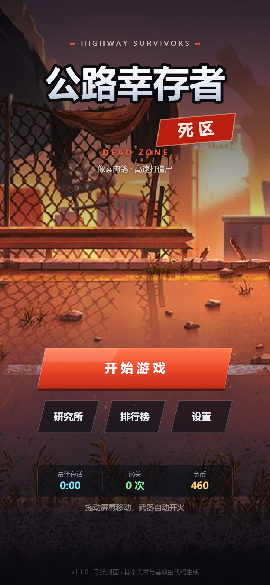 | 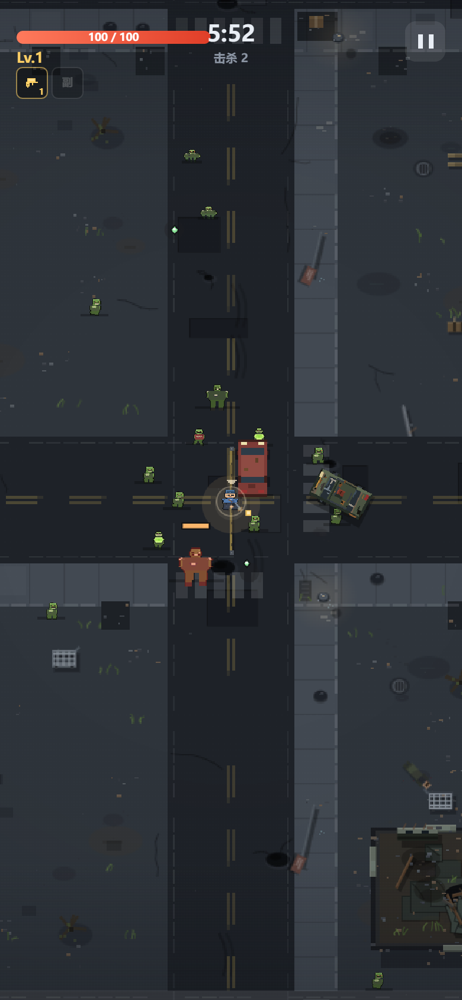 |
| 标题与主视觉 | 局内：破败街区、尸群，主武器始终握在手上 |
| 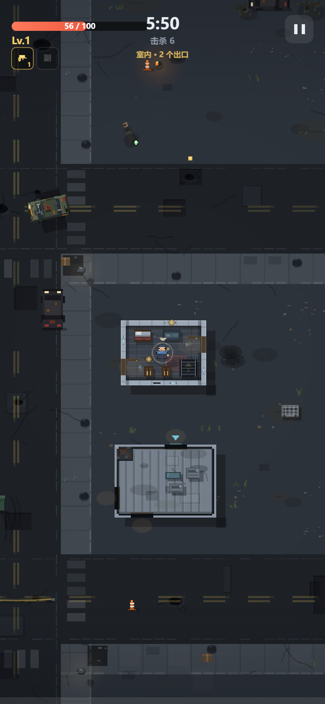 | 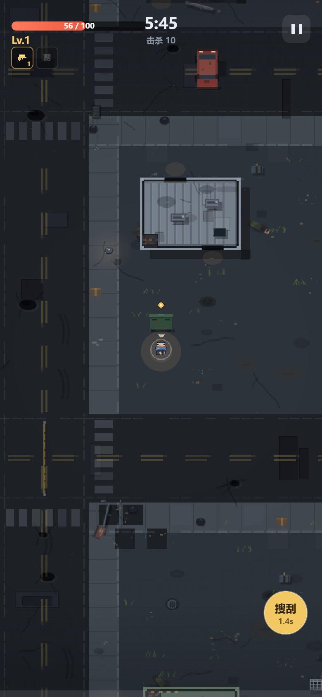 |
| 进入房屋：屋顶淡出，露出室内家具与搜刮点 | 靠近家具或车壳时出现搜刮按钮 |
| 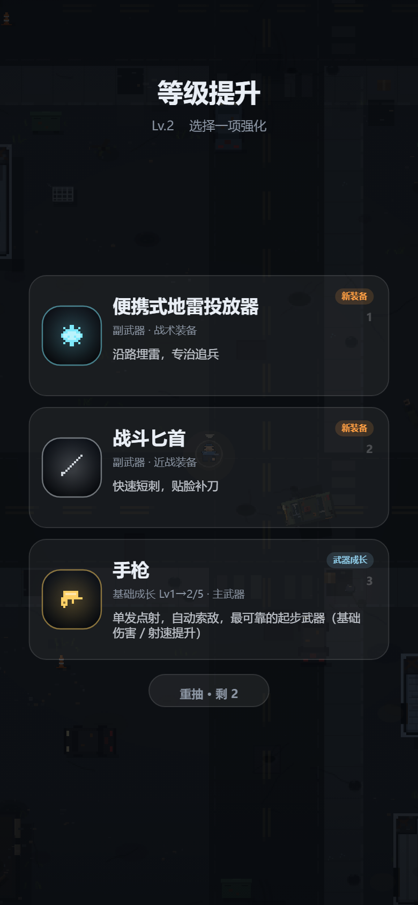 | 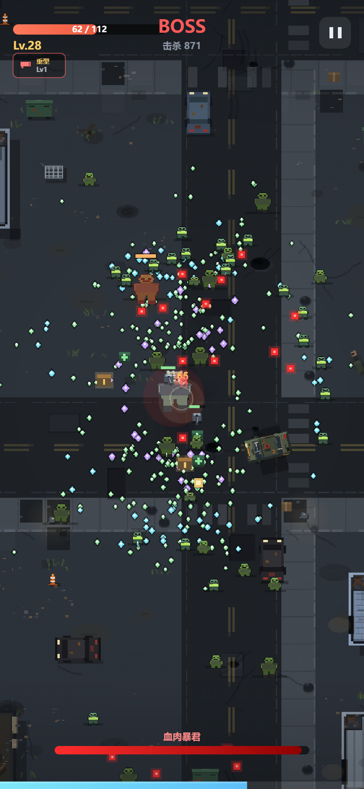 |
| 升级三选一，底部「重抽 · 剩 N」 | 区域首领入场 |
| 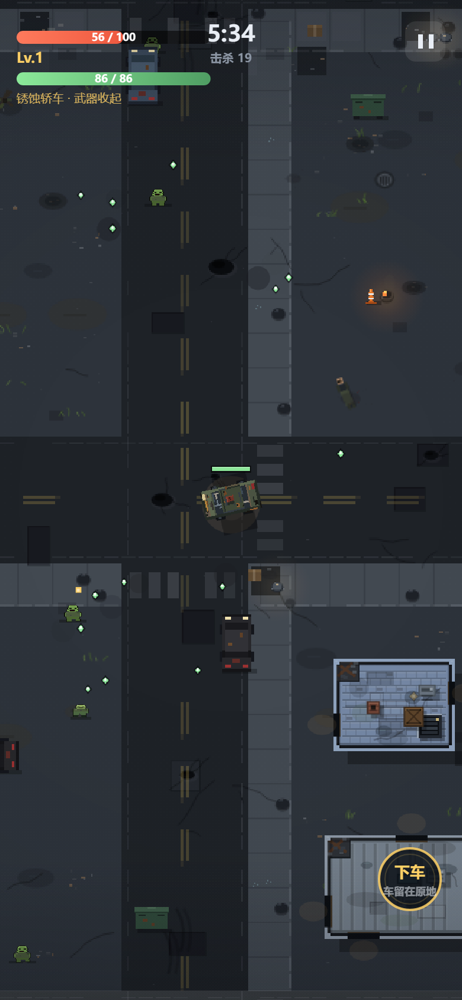 | 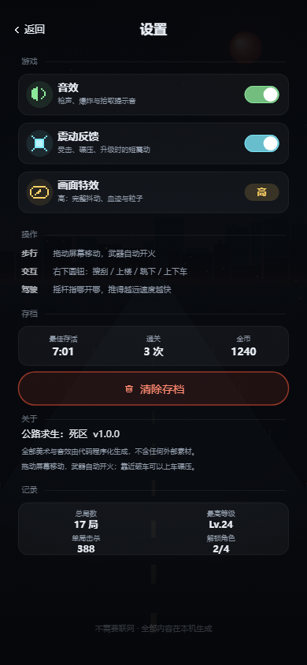 |
| 开上路边破车：武器全收起，靠车头碾压 | 设置：音效 / 背景音乐 / 震动 / 画面特效 / 清存档 |
| 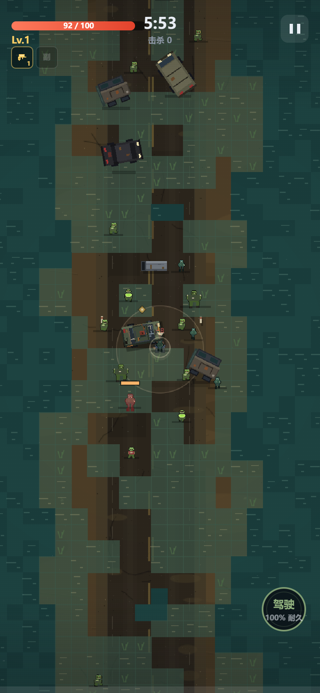 | 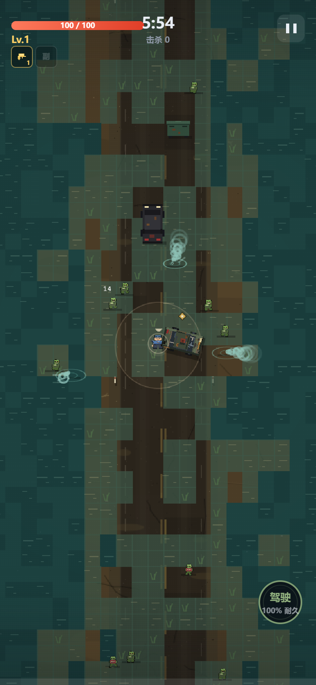 |
| 锈水高速：浅水减速、深水极慢、半沉车残骸（固定不可推） | 水鬼潜渡：水里几乎不减速，深水是它的近路 |
| 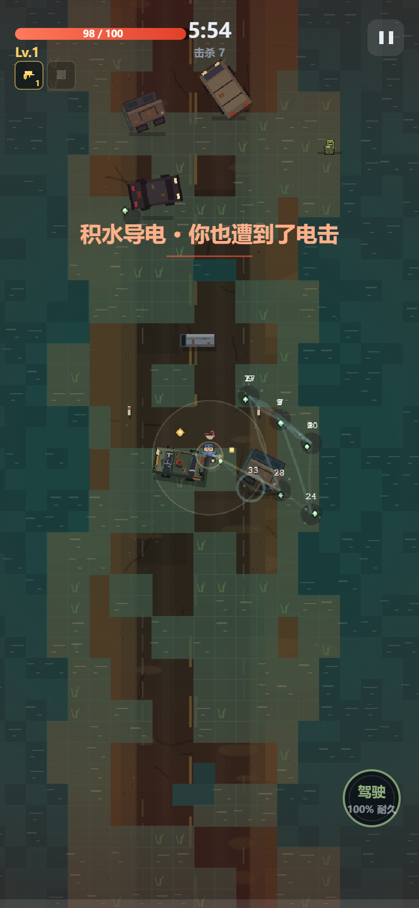 | 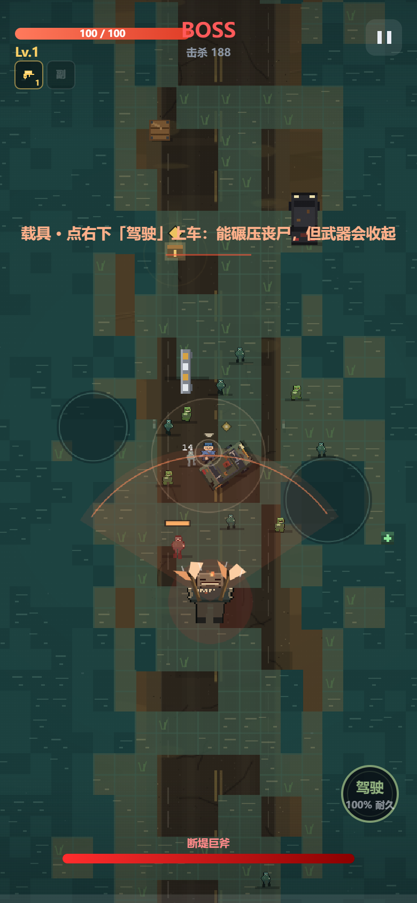 |
| 连锁闪电：每几次开火拉出一道电弧，连跳多个目标 | 断堤巨斧：交叉斩扇形预警 |
| 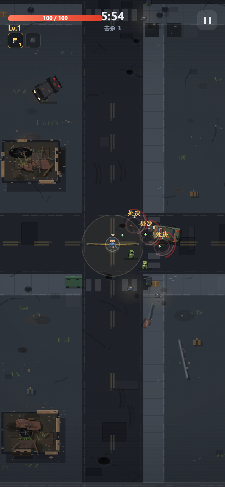 |  |
| 处决：血线以下的敌人一命中就当场斩杀（交叉红痕 + 处决字） | 升级三选一：卡面写明换装代价 |
| 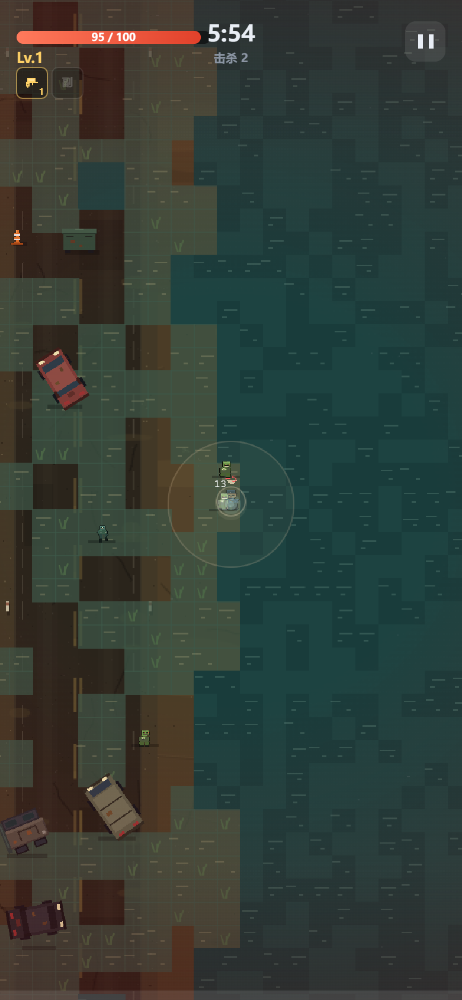 | 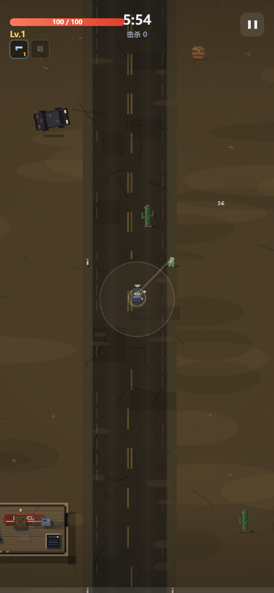 |
| 深水能走了：只剩三成速度，脚下留着涟漪 | 鱼叉枪：命中把猎物拽近，拖出一道锁链 |
| 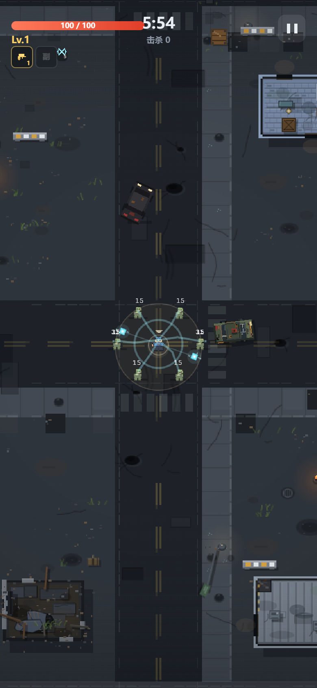 | 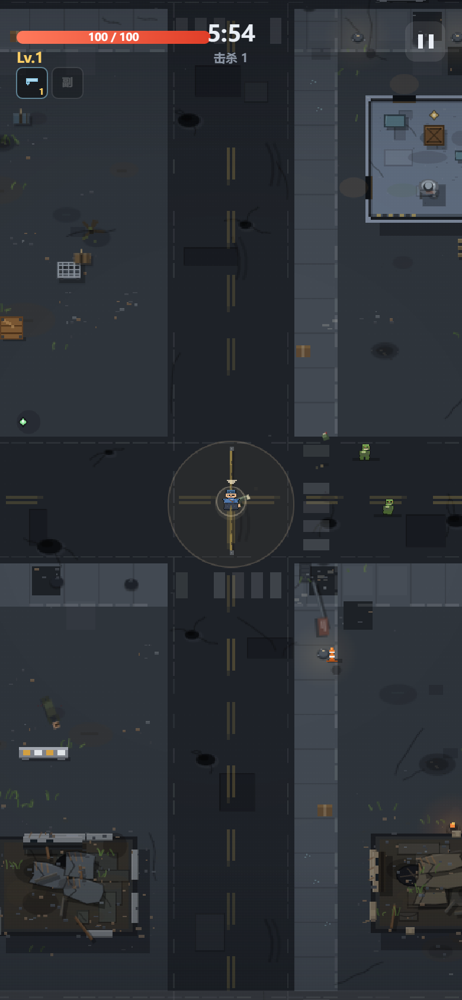 |
| 电磁轨道球：周期过载放电，电弧连跳多个目标 | 榴弹发射器：从枪口打出，不再是甩手雷 |
| 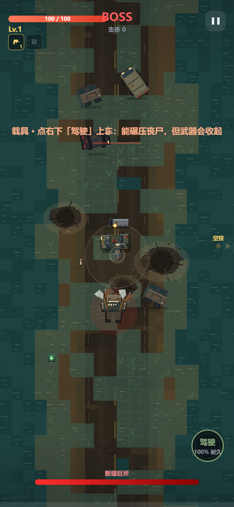 | 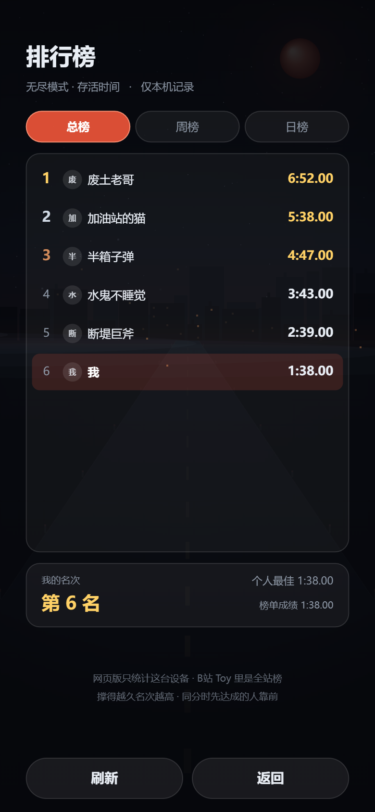 |
| 双斧横扫 + 被砸烂的地面（碎土坑、裂纹、崩碎石块） | 排行榜：无尽模式存活时间，前 10 名 + 我的名次 |

---

## 目录

1. [核心循环](#1-核心循环)
2. [跑起来](#2-跑起来)
3. [操作](#3-操作)
4. [内容一览](#4-内容一览)
5. [目录结构](#5-目录结构)
6. [调参地图](#6-调参地图)
7. [自测与工具](#7-自测与工具)
8. [美术与音频管线](#8-美术与音频管线)
9. [技术要点](#9-技术要点)
10. [已知限制与下一步](#10-已知限制与下一步)
11. [附录：预览版调试参数](#附录预览版调试参数)

---

## 1. 核心循环

```
选角色 → 选地图 → 局内 6 分钟（走位 / 打怪 / 升级 / 搜刮 / 开车）
      → 6:00 首领登场 → 击杀通关（或死亡结算）
      → 带金币回研究所，买永久强化 / 解锁角色 → 下一局
```

- **顺序解锁**：通关当前区域才解锁下一张地图（末世街区 → 死区之夜 → 荒漠公路 → 锈水高速）。
- **金币只有两个来源**：局内搜刮（砸车壳、木箱、室内家具、楼顶物资，以及击杀 3.5% 掉落的零钱）
  和**通关奖励**。击杀数、存活时长、精英击杀**都不折算金币**。
- **通关奖励按难度给**：末世街区 30 / 死区之夜 50 / 荒漠公路 80 / 锈水高速 110。这是额定值，不吃任何倍率；
  没通关就只带走搜刮到的那一点。

---

## 2. 跑起来

### 微信开发者工具

1. 打开 **微信开发者工具** → 新建项目 → 选择 **小游戏**。
2. 目录选 `D:\Code\WeChat\HighwaySurvivorsDeadZone`。
3. AppID 填自己的（没有就选「测试号」）；要发布时把 `project.config.json` 的
   `"appid": "touristappid"` 换成真实 AppID。
4. 点「编译」。入口是根目录 `game.js`，`game.json` 已声明竖屏。

### 浏览器单文件

```bash
node tools/build-browser.js     # → dist/highway-survivors.html
```

图集、封面、BGM 全部内联成 data URI，双击即玩；改完源码要重跑一次。

### 无头（Node）

所有逻辑都能在 Node 里跑，`tools/` 下的脚本自带 canvas 桩，不需要浏览器：

```bash
node tools/smoke.js             # 逻辑回归，必须全绿
```

---

## 3. 操作

| 操作 | 说明 |
| --- | --- |
| 拖动屏幕任意位置 | 出现虚拟摇杆，控制角色移动 |
| 右下「搜刮」 | 靠近车壳 / 木箱 / 家具 / 楼顶物资时出现，站桩 1.2~1.6 秒；期间无法攻击，挨打或移动会中断 |
| 楼梯 | 楼内靠近楼梯出现「上楼」，楼顶楼梯口出现「下楼」 |
| 楼顶边缘 | 靠近女儿墙出现「跳下」，按楼层高度扣血 |
| 载具 | 靠近能开的车 → 「驾驶」；开车时武器全部收起，靠车头碾压，再点「下车」把车留在原地 |
| 武器 | 全自动索敌开火，不需要瞄准。主武器 1 格、副武器 1 格，重型武器独占两格 |
| 自动装备 | 不占手持槽，自动索敌 / 环绕 / 部署 / 区域 / 打击 / 辅助，同类有件数上限 |
| 升级 | 暂停并弹出三张卡，点一张；每局 2 次「重抽」 |
| 键盘（浏览器） | `WASD` / 方向键移动，`1` `2` `3` 选卡，`Esc` 暂停 |

---

## 4. 内容一览

### 角色（金币解锁）

| 角色 | 价格 | 定位 | 开局 |
| --- | --- | --- | --- |
| 退伍士兵 | 免费 | 均衡 | 手枪，伤害 +10% |
| 战地医生 | 300 | 续航 | 冲锋枪 + 治疗注射器，持续回血 |
| 废土机械师 | 700 | 肉盾 | 链锯 + 旋转飞刀，减伤 |
| 拾荒者 | 1200 | 高风险 | 霰弹枪 + 飞刀，伤害 / 移速 +22%，只有 70 血 |

### 地图与首领

| 地图 | 特色 | 首领 | 通关奖励 |
| --- | --- | --- | --- |
| 末世街区 | 白天街道，车壳掩体 + 楼群搜刮 | 血肉暴君（冲锋 / 召唤 / 楼顶投石） | 30 |
| 死区之夜 | 夜视受限、射程 −32%，刷怪更密 | 扫射暴君（加特林弹幕，枪管会过热） | 50 |
| 荒漠公路 | 直路沙野，路边房屋与汽车旅馆 | 猎杀者（三段扑杀 + 狂暴嚎叫） | 80 |
| 锈水高速 | 被洪水淹没的立交，浅水减速 / 深水极慢 / 残骸固定 / 积水导电 | 断堤巨斧（交叉斩 + 跃劈 + 砸烂地面） | 110 |

### 敌人

9 种杂兵：游荡者 / 疾行者 / 爬行者 / 吐酸者 / 扑袭者（蓄力猛扑）/ 呕酸尸（矩形毒液）/
壮汉 / 持枪匪徒 / 水鬼（浅水加速、潜渡横穿深水），加 4 名区域首领。

精英每 42 秒刷新（6 倍血量、红化、必掉宝箱）；局内事件每 44~60 秒触发一次：
尸潮 / 猎犬群 / 补给空投 / 血月。锈水高速有 56% 概率改为专属事件：
抽水机排开深水 18 秒，或桥下安全屋开放 12 秒（回血并把普通丧尸推到圈外）。

### 装备与成长

| 项目 | 数量 | 说明 |
| --- | --- | --- |
| 主武器 | 35 | 现代枪械 / 特殊枪械 / 近战 / 特殊近战 |
| 副武器 | 27 | 轻型枪械 / 投射 / 爆炸物 / 战术装备 / 近战 / 辅助 |
| 重型武器 | 10 | 独占主副两格，移动减速、前摇长、弹道笨重 |
| 自动装备 | 23 | 跟随 / 环绕 / 环带 / 部署 / 区域 / 打击 / 辅助（同类上限见 `D.autoCaps`） |
| 进化 | 57 组 | 主 35 / 副 12 / 重 10，需要 Lv5 + 一条属性达标 |
| 被动 | 30 条 | 24 条通用属性（含连锁闪电）+ 6 件防护装备（护人 3 + 护车 3） |
| 联动 | 16 组 | 前 10 组要「装备 + 属性」，后 6 组纯属性组合，任何 build 都能成流派 |
| 专属分支 | 13 套机制模板 + 17 件点名覆盖 | 每件 3 条，按攻击机制自动匹配 |
| 成就 | 10 | 累计击杀 / 通关 / 单局等级 / 金币 / 全角色 … |

**成长规则**

- 每件装备 **5 级基础成长 + 3 条专属分支**；升到 5 级后升级界面**必定**出现进化卡或「进化预备」卡。
- 进化形态还能走 **觉醒 Lv1→3**（继承本体 60% 成长、沿用本体分支），质变不是终点。
- 「穿透 / 分裂 / 攻速」按机制换算：近战穿透变目标数、分裂变回响斩、爆炸物分裂变额外弹体；
  短冷却武器吃攻速、长冷却武器吃冷却缩减 —— 不会出现点了完全没用的卡。
- **抽卡来源权重**：通用 40 / 专属 30 / 新装备 8+ / 联动 15 / 进化 5（幸运值会改写比例）；
  同来源最多 2 张，同一件装备一轮只出现一次。副武器位或自动装备位空着时，
  新装备权重额外 +12 / +5，避免构筑一直只长数值。
- **主武器每局只能换一次**：换过之后 `p.mainLocked` 生效，升级池不再给主武器；
  此后唯一来源是搜刮（40% 概率翻出，会停下来问要不要换）。
- **副武器替换要确认**：换掉现有副武器会先弹确认框，取消不消耗本次升级。

### 模式

- **普通**：6 分钟 → 首领 → 通关。
- **无尽**：首领按 血肉 → 扫射 → 猎杀 → 断堤 轮换（从本图 Boss 开始），血量 `1300 × 1.45^(场次-1)`，间隔从 100 秒逐场收到 60 秒；
  杂兵**按地图顺序换场**（横幅会提示）：末世街区 0s → 死区之夜 2:00（扑袭者）→ 荒漠公路 3:15（持枪匪徒）→
  锈水高速 3:55（水鬼），四张图的杂兵最终都会出场。无尽没有通关奖励，只带走搜刮所得。

### 载具与场景

- 路边偶尔停着能开的车：锈蚀轿车（快而脆）/ 报废皮卡（慢而硬）。撞车、撞墙、撞丧尸、被啃都掉耐久，
  归零当场报废（油箱爆炸 + 人被甩出）。**自己的子弹只会被车壳挡下，不掉耐久**。
- 街区里约四成建筑可以进入（2~3 个门洞、室内家具、楼梯、楼顶），其余是实心废墟。
  楼顶能躲地面尸群，但丧尸会爬楼梯，首领也会往楼上扔碎石。
- 场景道具按 192 区块哈希生成：废车 / 隔离墩 / 垃圾箱 / 木箱 / 轮胎堆 / 路锥。
  实心道具挡走位，车与隔离墩还会挡子弹。

---

## 5. 目录结构

```
game.js                  小游戏入口（按依赖顺序 require 所有模块）
game.json                竖屏配置
project.config.json      开发者工具工程配置（appid / 打包忽略规则）
assets/
  sprites.png            精灵图集（290x530，66 帧，13 KB）
  sprites.js / .json     图集帧表（自动生成，运行时读 .js）
  title-bg.jpg           封面源图（只给 tools/build-title-bg.js 用，不进包）
  title-bg.js            封面 base64（运行时读 HS.TitleBgData）
bgm/bgm.mp3              菜单页循环 BGM（60 秒，842 KB；.wav 原件不进包）
src/
  core/
    util.js              数学 / 随机 / 哈希 / 颜色
    platform.js          平台适配（wx / 浏览器 / Node 桩）、双分辨率画布、存储
    input.js             动态虚拟摇杆 + 点击 + 键盘
    sprites.js           图集客户端：按帧矩形切片绘制
    audio.js             程序化音效（18 音色 / 52 art 映射）+ BGM 播控
  host/
    host.js              宿主适配层门面：排行榜状态机 / 缓存 / 退避 / 云存档 / 前后台
    toy.js               B站 Toy：平台排行榜 + 云存储（限流指数退避）
    wx.js                微信：wx storage；排行榜待接入（好友榜 / 云开发二选一）
    web.js               浏览器 / Node：本机记录当榜单，开发时能跑通整条链路
  data/
    spriteDefs.js        美术源：字符点阵 + 调色板（只给生成器用）
    enemies.js           敌人表（含精英系数与首领招式参数）
    weapons.js           手持装备 72 件 + 57 组进化 + 槽位池
    autogear.js          自动装备 23 件 + 同类上限 D.autoCaps
    upgrades.js          专属分支（13 套机制模板 + 17 件点名覆盖）+ 16 组联动
    passives.js          24 条通用属性 + 6 件防护装备
    chars.js             角色 / 地图（含 clearGold）/ 永久强化 / 成就
  world/
    water.js             锈水高速：深浅水、导电、固定残骸、抽水机 / 安全屋事件
    props.js             场景道具表（碰撞 / 子弹遮挡 / 搜刮产出）
    vehicles.js          载具表（轿车 / 皮卡 / 生成概率）
    icons.js             67 个 12x12 字符点阵图标
  game/
    save.js              存档读写 / 字段补默认 / 云存档合并
    game.js              状态机、抽卡、刷怪导演、结算
    gear.js              装备数值结算（成长 / 分支 / 换算）、槽位、开火机制
    auto.js              自动装备运行时（跟随 / 环绕 / 部署 / 区域 / 打击）
    combat.js            弹道、敌人 AI（含上楼顶）、伤害、掉落、特效
    vehicle.js           载具：生成 / 上下车 / 驾驶物理 / 碾压 / 磨损 / 报废
    render.js            世界渲染：街道 / 建筑内景 / 屋顶 / 废墟 / 夜间
    ui.js                标题 / 设置 / 选图 / 研究所 / HUD / 升级卡 / 结算
  world/
    buildings.js         可进入建筑与废墟生成、门墙、家具、楼梯、屋顶
    obstacles.js         道具生成 / 碰撞 / 子弹遮挡 / 搜刮查询
  main.js                启动与主循环
tools/                   见第 7 节
dist/highway-survivors.html   可直接玩的单文件预览版
docs/                    截图、图标对照图、步态分解图、ROADMAP、版本更新说明、多平台发布说明
```

---

## 6. 调参地图

改数值基本只需要动数据表；逻辑参数集中在少数几个常量上。

| 想改什么 | 位置 |
| --- | --- |
| 单局时长 / 敌人上限 / 自动装备上限 | `src/game/game.js` → `RUN_TIME`、`MAX_ENEMIES`、`MAX_AUTOS` |
| 刷怪速度 / 敌人血量成长 | `src/game/game.js` → `updateDirector`（`1.0 + 分钟×0.46`、`1 + 分钟×0.52`） |
| 升级经验曲线 | `src/game/game.js` → `xpFor` |
| 抽卡来源权重 | `src/game/game.js` → `sourceWeights` |
| 拾取半径 | `src/game/game.js` → `recalc` 里的 `p.magnet` |
| 搜刮时长 | `src/game/game.js` → `beginSearch`（默认 1.4 / 家具 1.2 / 楼顶箱 1.6） |
| **金币规则** | `src/game/game.js` → `finishRun`；每图奖励在 `src/data/chars.js` → `clearGold` |
| 敌人血量 / 速度 / 伤害 / 首领招式 | `src/data/enemies.js` |
| 武器每级数值 / 进化条件 | `src/data/weapons.js` |
| 专属分支 / 联动效果 | `src/data/upgrades.js` |
| 通用属性 / 防护装备 | `src/data/passives.js` |
| 角色 / 地图加成 / 永久强化价格 / 成就 | `src/data/chars.js` |
| 载具耐久 / 速度 / 转向 / 碾压伤害 | `src/data/vehicles.js` |
| 撞各种道具掉多少耐久 | `src/data/props.js` → 每件道具的 `crash`（`brittle` = 能撞碎） |
| 驾驶手感（惯性转弯 / 侧滑） | `src/game/vehicle.js` → `V.drive`（`turnV` / `mvDir` 的响应速度） |
| 车身碰撞胶囊 / 扫地探针 | `src/game/vehicle.js` → `resolveBody` |
| 建筑大小 / 每街区数量 / 废墟比例 | `src/world/buildings.js` → `DIMS`、`generate` |
| 某个图标的长相 | `src/data/icons.js`（`#` 主色 / `+` 高光 / `-` 暗部 / `.` 透明） |
| 音效音量 | `src/core/audio.js` → `SFX_VOL`（整体）或 `SFX` 表里各条 |
| BGM 音量 / 曲目 | `src/core/audio.js` → `bgmVol`、`BGM_SRC` |
| 界面文案与排版 | `src/game/ui.js`（改完跑 `node tools/check-layout.js`） |

---

## 7. 自测与工具

```bash
# —— 改完代码至少跑这三条 ——
node tools/smoke.js          # 逻辑回归：开局/战斗/升级/进化/首领/胜负/存档/无尽/设置/载具/持械/投掷
node tools/balance.js 6      # 平衡探测：自动模拟 6 局
node tools/build-browser.js  # 重新打包 dist/highway-survivors.html

# —— 改到对应内容时 ——
node tools/audit-gear.js         # 装备数据审查（悬空字段 / 空分支 / 音色覆盖）
node tools/check-bosses.js       # 首领招式与血量
node tools/check-gold.js         # 金币结算与选图文案
node tools/econ-gold.js          # 一局大概能带多少金币回去
node tools/check-layout.js       # 界面排版（越界 / 压控件 / 居中，4 种屏幕比例）
node tools/check-audio.js        # 音效输出链（总增益 → 软限幅 → destination）
node tools/sfx-level.js          # 各音效实际电平表（和 pickup 对照）
node tools/check-save.js         # 存档迁移与坏档兜底
node tools/check-melee-range.js  # 近战判定范围
node tools/check-vomiter.js      # 呕酸尸毒液判定
node tools/build-sprites.js      # 点阵美术 → 图集（改完画面必跑）
node tools/build-title-bg.js     # 封面 jpg → base64 模块
node tools/preview-icons.js      # 67 个图标 → docs/icons.png
node tools/preview-sprites.js    # 全部精灵放大 → docs/sprites-preview.png
```

**当前基线**（`balance.js` 6 局）：平均存活约 218 秒，通关 0~1/6。脚本会自动走位、
按「进化 > 武器升级 > 被动」选卡，可以当作「中等水平玩家」的下限参考。
真实玩家更强；要继续压难度，往 `updateDirector` 的刷怪曲线和 `enemies.js` 的血量上找。

---

## 8. 美术与音频管线

### 精灵图集

运行时**只认图集**，不做任何逐像素绘制：

```
src/data/spriteDefs.js  ──build-sprites.js──▶  assets/sprites.png   290x530 / 61 帧 / 12 KB
   字符点阵 + 调色板                           assets/sprites.js    帧表（运行时读）
                                              assets/sprites.json  同一份帧表（给工具看）
                                                     │
                                        src/core/sprites.js 按帧矩形 drawImage
```

- **改角色造型**：改 `tools/gen-sprites-2x.js` 里的点阵稿再跑它。
  `replaceDef` 会整体覆盖 `spriteDefs.js` 的 `rows`（直接改 rows 会被冲掉），新增字母要手工加进 `pal`。
- **渲染超采样**：世界缓冲按 `P.SS = 2` 倍密度渲染，逻辑坐标、视野、手感都不变，只是像素更细。
  角色点阵因此是「原尺寸 ×2」：帧表里带 `s: 0.5`，绘制时缩回原来的屏幕占位。
- **行走动画**：角色是单帧精灵，`R.drawActor` 把一帧拆成「上半身 + 左腿 + 右腿」三段分别画
  （起伏 / 重心 / 前倾 / 跨步）。腿部起始行 `lr` 由 `build-sprites.js` 自动检测，改点阵不用手工维护。
  `gait` 取自「这一帧真的挪动了多少」，顶着墙或卡在车头时腿会停，不会原地踏步。
- **换手绘**：按 `assets/sprites.json` 的帧矩形重画 `sprites.png`，帧名与矩形不变就不用改代码。

### UI 图标

界面图标**不走图集**，是 `src/data/icons.js` 里的 67 个 12x12 字符点阵，运行时按格子 `fillRect`：

```
'............'   # 主色
'....####....'   + 高光（向白混 46%）
'..##++++##..'   - 暗部（向黑混 46%）
'.#+++++++-#.'   . 透明
```

尺寸取 12 的整数倍（24 / 36）才不会重采样发虚；三档色调先拆组缓存，每个图标只切 3 次 `fillStyle`。
改完跑 `node tools/preview-icons.js`：先按 12x12 校验，再拼成 `docs/icons.png` 供肉眼验收。

### 封面图

标题页背景是一张烘焙好的封面（`assets/title-bg.jpg` → `node tools/build-title-bg.js` → base64 模块）。
加载中或加载失败会自动退回**程序化场景**（夜空 / 血月 / 城市剪影 / 透视公路），首帧不等图。

### 音效

全部运行时合成，不依赖任何音频文件：

- **18 种音色**由两层叠加：噪声层定质感（带通扫频 + 指数衰减）、音调层定口径（波形 + 滑音）。
  配一张 **52 个 `art` → 音色**的映射表（`Audio.ART_SFX`）；加武器忘配音色时 `audit-gear` 会报红。
- **音量以「吸收经验」那条 `pickup` 为基准校准**：开火 +4 dB、命中齐平、爆炸 +6 dB、
  持续音（喷火 / 链锯）−3 dB。改完跑 `node tools/sfx-level.js` 看实测 RMS。
- 输出链：`SFX_VOL` 总增益 → **软限幅**（`|x| ≤ 0.6` 严格线性，超出按 tanh 压到 0.95）→ destination。
  满屏交火十几发叠在一起也不会爆音；平台不支持 WaveShaper 时自动回退直连。
- **击中音**统一在 `hurtEnemy` 里按伤害来源分音色（子弹闷噗 / 近战割裂 / 能量电火花），
  自带节流（普通 80 ms、暴击 45 ms），暴击额外加一层「叮」。
- **BGM**（`bgm/bgm.mp3`，60 秒循环，842 KB）**只在菜单页播放**（标题 / 选图 / 研究所 / 设置），
  进局内、暂停、结算一律静音；设置里可单独关掉。浏览器与 iOS 不允许无手势播放，所以要等第一次点击。

---

## 9. 技术要点

- **双分辨率渲染**：世界画进 `320 × VH` 的低分辨率离屏 canvas，再整数放大到屏幕，像素颗粒稳定且省性能；
  HUD 与菜单用原生分辨率绘制，中文不糊。
- **预烘焙精灵**：61 帧全部预生成（4 套角色配色、8 种杂兵 + 3 首领、车壳道具、精英红化、受击白闪），
  运行时只有 `drawImage`，没有 tint 计算，帧名即索引。
- **程序化地图**：道路按 384 周期分区，斑马线 / 双黄线 / 井盖 / 油污 / 裂缝 / 尸体 / 燃烧油桶
  全部由坐标哈希决定，无限地图不需要任何关卡数据。
- **建筑与寻路**：可进入建筑有门洞、家具、楼梯与楼顶；同层追击会把楼当成凸矩形沿外角**绕行**，
  只有玩家真的躲进楼里才钻门洞。被家具 / 车壳 / 同伴挤住时还有一层「切向脱困」。
- **载具**：只有横竖两张帧，靠「选主轴 + 残余角度旋转」表达任意朝向；碰撞用沿车身的**胶囊**
  而不是旋转包围盒，贴着斜停的车角走不会被空气墙挡住。转向是角速度惯性模型（`turnV` 一阶响应），
  车身朝向与行进方向分离，急打方向时会先斜着滑一点。
- **驾驶时玩家坐标就是车身中心**：每帧把车体坐标回写 `v.x / v.y`，渲染、耐久条、残骸全读它。
- **持械与投掷**：主武器每帧按瞄准角重画（`R.drawGun`），能做后坐、枪口焰、
  枪口朝身后时画在躯干之下；投掷走两段式（先登记抬手，到出手帧才生成弹道），瓶子不会提前飞出去。
- **装备系统**：统一字段 `slot / cat / fam / mech / base / g / up / evo / rarity / tags`，新增武器只改数据。
  `Gear.stat` 是唯一的数值出口（成长 → 专属分支 → 通用属性），结果按 `statVer` 缓存。
- **性能**：空间网格做敌人分离与近邻查询、`dead` 标记就地压缩、粒子上限、敌人上限 120、
  屏幕外敌人跳过绘制、静态背景烘焙进离屏缓存。
- **低配模式**：设置里「画面特效」切低后 `P.fxLow = true`，镜头抖动降到 30%、跳过血迹贴花，并写进存档。
- **一套代码两个平台**：核心只调 `HS.Host`（排行榜 / 云存档 / 身份 / 切后台），
  宿主差异全在 `src/host/` 的四个 adapter 里；微信与 B站 Toy 的存档走各自的 storage，
  云端 key 带宿主前缀，排行榜由平台按作品隔离。细节见 [`docs/多平台发布.md`](docs/多平台发布.md)。
- **排行榜**：只记无尽模式存活时间，分数是整数百分秒（`秒 × 100`），提交幂等、只增不减；
  榜单拉一次缓存 30 秒不轮询，撞到 Toy 的 `307044` 限流走指数退避。
- **工程约定**：小游戏环境**不用 ES6+**（`const` / `let` / 箭头函数 / 模板字符串一律不用），
  模块全部挂在全局 `HS` 下用 IIFE 包裹，新增文件必须在 `game.js` 里按依赖顺序 `require`。

---

## 10. 已知限制与下一步

1. **没有新手引导**：第一局建议看「研究所 → 角色」页底部的「上路须知」。
2. **音效是合成的**，风格偏 8-bit；换 BGM 直接替换 `bgm/bgm.mp3`（保持 60 秒循环体感最好）。
3. **排行榜**：B站 Toy 已接（无尽模式存活时间）；微信侧还差一个平台工程（开放数据域好友榜，
   或者云开发全服榜），代码位置和补法见 [`docs/多平台发布.md`](docs/多平台发布.md)。
   **分享 / 广告**仍只有接口位置，需要 AppID 与平台配置。
4. **低端机掉帧**：先把「设置 → 画面特效」切到低；还不够就降 `MAX_ENEMIES` 与 `P.dpr` 上限。

更细的待办清单（P0 上线必需 / P1 留存 / P2 内容）见 [`docs/ROADMAP.md`](docs/ROADMAP.md)，
逐版本改动见 [`docs/版本更新说明.md`](docs/版本更新说明.md)。

### 常见问题

| 现象 | 处理 |
| --- | --- |
| 没有声音 | 浏览器 / iOS 要求先有用户手势：点一下屏幕；再确认设置里「音效」没关 |
| 进局内背景音乐停了 | 设计如此，BGM 只在菜单页播放 |
| 开发者工具报 `Unexpected end of JSON input`（栈全在 `index.js:1`） | 那是工具自身（Nightly 版）或系统代理没开导致的空响应，不是游戏代码；换稳定版或关掉代理 |
| 预览版打开是空白 | 跑一次 `node tools/build-browser.js` 重新构建（图集与 BGM 是构建时内联的） |

---

## 附录：预览版调试参数

`dist/highway-survivors.html` 支持 query 参数直接跳到某个界面看效果：

```
?screen=run&t=150&god=1     开一局并快进到 2:30（god 不掉血）
?screen=levelup&t=90        直接看升级三选一
?screen=result&win=1        直接看通关结算
?screen=meta&tab=up         研究所强化页（tab=char / up / arc）
?screen=mapselect           选图页
?screen=run&inside=1        把玩家放进最近的完整建筑
?screen=run&roof=1&edge=1   直接放到楼顶边缘
?screen=run&t=90&veh=1      直接坐进一辆载具
?screen=run&cards=gear      把 6 件防护装备塞进升级界面
?screen=settings            设置页（wipe=1 弹清档确认，fxlow=1 特效显示「低」）
?dummy=1                    伪造存档（金币 1240 / 3 次通关 / 三张地图 / 两个角色）
?w=340&h=736                强制逻辑分辨率（无头截图用）
```

`docs/` 里还有几张验收用的对照图：`icons.png`（67 个图标）、`sprites-preview.png`（全部精灵）、
`sprite-gait.png`（步态 8 相位分解）——改完美术先看它们。
