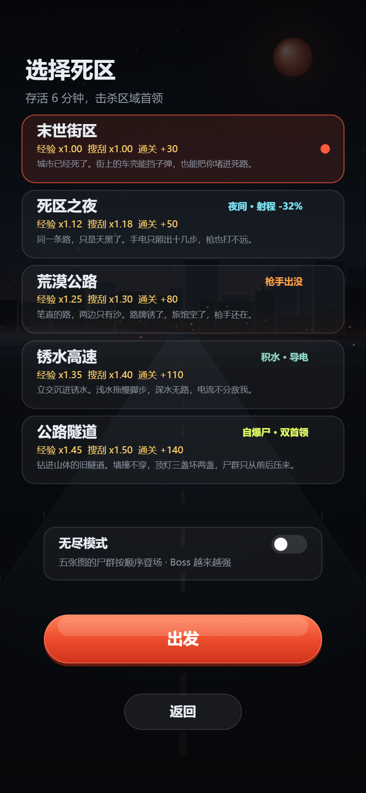
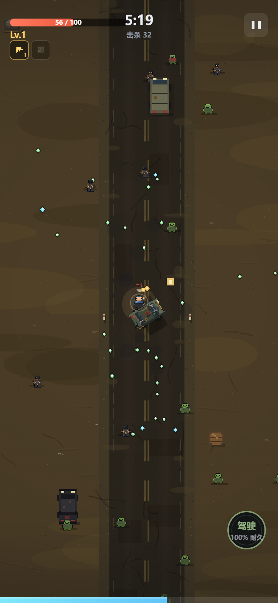
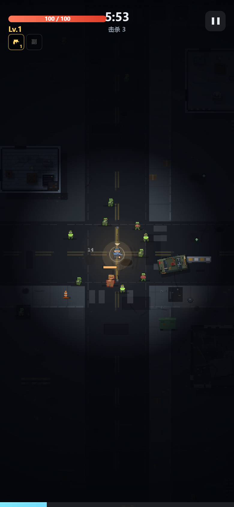
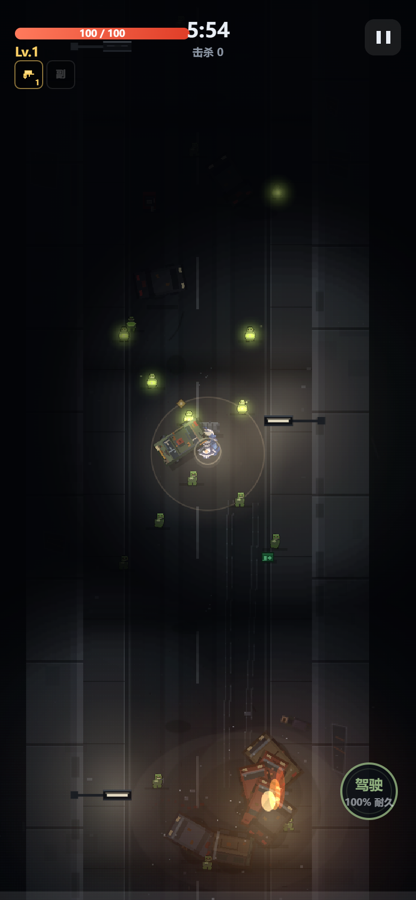
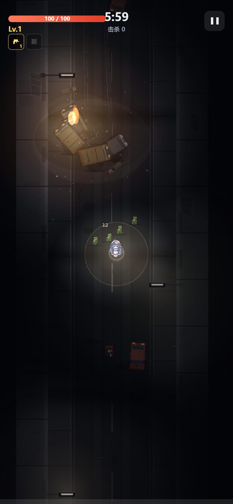
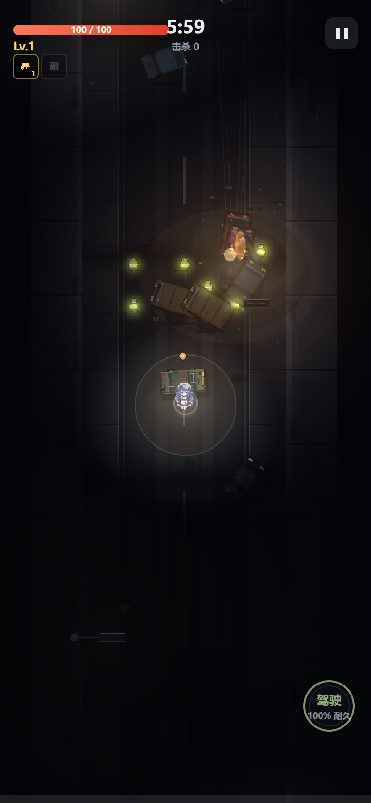
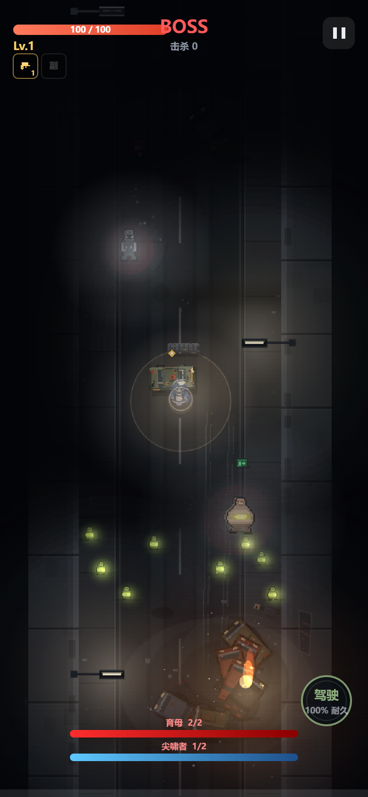
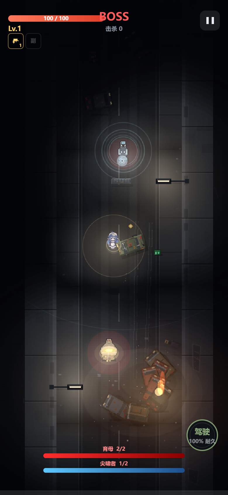
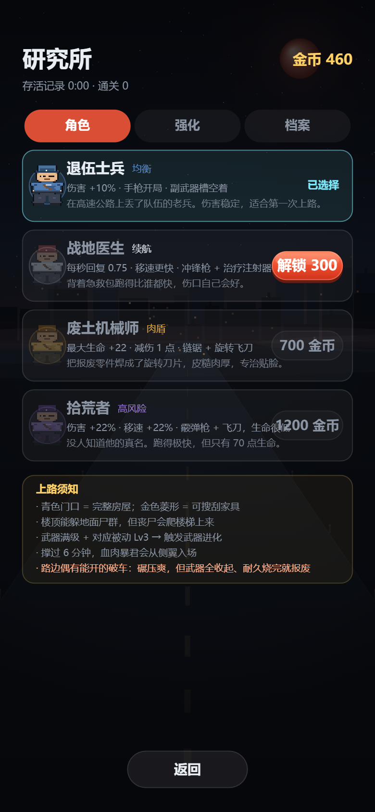
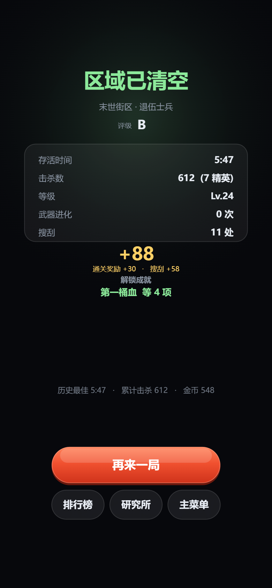

# 公路幸存者：死区 —— 游戏介绍

> **Highway Survivors: Dead Zone**
> 竖屏像素肉鸽 · 一条堵死的高速公路 · 一局 6 分钟
>
> 试玩：https://juicesyo.github.io/highway-survivors-dead-zone/

---

## 一句话

你是一个在末世公路上丢了队伍的老兵。往前是死区，往后是尸群，手里只有一把剩半个弹匣的旧手枪。
**撑过 6 分钟、打掉从侧翼压上来的区域首领**，然后带着搜刮到的废料金币回研究所，把自己变得更强一点，再上路。

这是一款**幸存者品类（Survivors-like）**的竖屏肉鸽：不用瞄准，武器全自动开火，
你的全部注意力只需要花在两件事上 —— **往哪走**，和**这道升级选什么卡**。


---

## 核心循环

```
选角色 → 选地图 → 局内 6 分钟（走位 / 打怪 / 升级 / 搜刮 / 开上车）
      → 6:00 首领登场 → 击杀通关（或死亡结算）
      → 带金币回研究所买永久强化 → 下一局
```

每一局都是完整的一段，输了不白输：**局内搜刮到的金币会带走**，只是没有通关奖励。
五张地图按通关顺序解锁（末世街区 → 死区之夜 → 荒漠公路 → 锈水高速 → 公路隧道），难度是硬门槛而不是数值微调。



---

## 一局 6 分钟是怎么走的

| 时间 | 场上发生什么 | 你该做什么 |
| --- | --- | --- |
| 0:00 – 1:00 | 零散游荡者，主武器足够应付 | 边打边挪，把经验吃干净，尽快到 3 级 |
| 1:00 – 3:00 | 刷怪速率按分钟线性抬升，疾行者开始穿插 | 补齐第二件武器，决定这局走哪个流派 |
| 3:00 – 5:00 | 壮汉、呕酸尸混编，精英按固定节拍刷新 | 把主武器推到满级，准备进化 |
| 5:30 | 空投补给 | 抢，通常是这局最后一件好东西 |
| 6:00 | 区域首领从侧翼入场，血条挂到屏幕底部 | 一边绕一边输出，别站着换血 |

中途升级会**暂停整个世界**弹三张卡；每局还有 **2 次重抽**，卡池变大之后的安全阀。

打累了点右上角暂停：暂停页里有构筑总览，也有「设置」—— **音效、背景音乐、震动反馈、画面特效**
都能当场改，改完按「返回暂停」接着打，不用退出这一局。

> 镜头震动的幅度也跟着"连着炸"降下来了：自爆尸一串连环炸的时候，
> 屏幕不会一直晃到你分不清自己在哪（单发爆炸的手感没变）。


> 屏幕最底部那条青色细条是经验条，顶部是血条与击杀数，主武器会自动打最近的敌人。

---

## 五个核心系统

### 1. 手持武器：主 / 副 / 重型，格子是硬约束

- **主武器 1 格 + 副武器 1 格**，各持一把，自动索敌开火。
- **重型武器独占两格** —— 换上它就没有副武器了，换来的是压倒性的火力。
- 手持武器共 **73 件**（主 38 / 副 27 / 重 8），机制各异：手枪、霰弹、链锯、长矛突刺、
  喷火、榴弹、电磁、光束……每件的成长曲线和专属升级分支都不一样。
- 喷射类分两种元素：**火焰**（烧一片，龙息喷枪烧死的会连环爆）与**低温**（冻住一片，
  越冻越脆）。火焰和冰霜天生无视护甲 —— 实弹想打得动硬皮，就得点「破甲」。
- **红莲切割者**是唯一一把"永不断火"的武器：红色粗光束一直烧着，每秒 12 跳持续伤害。
  代价是它完全不吃射速与冷却（攻速、暴走、过热加速对它都无效）。
  进化成**熔核过载**之后还是**一道**光 —— 不会变成并排几道，只会更粗：
  同一目标被连着照会越来越烫（最多 +72%，断火半秒清零）。
- **主武器每局只能换一次**。换过之后升级卡池里不再出现主武器，想换只能靠局内搜刮撞运气 ——
  所以「开局这把要不要一直用到死」是个真实的决策。

### 2. 进化与觉醒：满级不是终点

武器推满级后会给出**进化卡**，变成同名但机制升级的终形态，共 **63 组**进化。
**每一条重型进化都有自己的机制**，不是把本体数值放大一遍：

- **弹幕墙**（重机枪）：不再瞄准，每发甩出一整圈**360° 螺旋弹幕**；
- **转管风暴**（加特林）：弹丸变大、伤害再抬一档；
- **攻城弩阵**（攻城弩）：**每支箭命中即炸**，穿透过去的每一段都炸；
- **湮灭炮**（轨道炮）：**3 秒蓄力**打出一道巨粗光柱，开火后光柱还会向外扩散着淡去；
- **炼狱**（重火焰）：烧过的地方会**留一片火**；
- **血肉磨坊**（重链锯）：**自带撕裂**，咬住就叠流血；
- **焚城**（重RPG）：破片；**剑刃风暴**（巨型光剑）：剑气。

进化之后还有 **Lv1→3 的「觉醒」**，所以满级进化不会让卡池突然变窄 ——
构筑是持续往上长的，不会在 4 级时撞到天花板。

### 3. 自动装备：不占手持槽的第二套系统

**23 件**自动装备，按类型分：自动索敌、环绕、部署、区域、打击、辅助，同类有件数上限。
它们不占手持格子，是构筑的「背景板」——环绕刀轮、自动炮台、地雷、光环，
把你漏掉的怪补掉。它们也有自己的专属分支和满级终形态。

### 4. 升级三选一：构筑的主战场


卡池有六类来源：**通用属性 / 武器专属 / 新装备 / 装备联动 / 进化 / 取舍**。
几个刻意做过的取舍：

- **取舍卡**：一张卡同时给你"得到"和"失去"，比如「超压装填」伤害 +22%、攻速 -8%，
  「轻量化」移速 +12%、伤害 -6%。卡面用两行分开写（绿的是得到、红的是代价），
  每张整局只能拿一次，且**不占通用属性槽** —— 它不该抢走成长空间，只是给"这局想怎么打"多开一条岔路。
- **近战的「攻击范围」吃满，形状按武器自己的打法变**：以前整条射程倍率对近战打对折，
  等于这张卡对近战永远半价；现在玩家投入的部分全额生效，夜图的射程惩罚仍只算一半。
  刀剑斧镰这类扇形挥砍**半径和弧角一起长**（挥得更远也扫得更开），长矛和锯子只加长
  （刃身随之变宽），拳套 / 冲击波只加半径，居合那种窄刺几乎不加弧角 —— 它的身份就是一条线。
- **刃返（稀有）**：近战挥砍 / 突刺时击落身边的敌方子弹。它**以前是近战白送的**，
  等于刀客天生免疫远程；现在收进卡池，想要"用身法换安全"得先付一次升级。
- **每轮三选一至少一张"改变打法"的卡**：联动 / 进化 / 带特殊机制的专属分支 / 取舍卡。
  全是「+14% 伤害」的三连是这套系统最容易让人疲倦的时刻，所以抽卡总得有个钩子；
  强机制优先，取舍卡兜底（一局最多兜底 6 次，免得反过来变成"每次都是它"）。

- 槽位空着的时候，新装备的权重会明显抬高 —— 否则玩家永远长不出副武器。
- 手持重型武器时**不会给副武器卡**（塞不进去，给了只会让人以为主武器被吞了）。
- 副武器替换会弹确认框 —— 一次误点不该毁掉整局。
- **新装备的出现概率按武器强度算，不按标签**：打得越狠的枪越稀有（最强档约是最弱的 1/5），
  所以"看着平平无奇"的喷火枪、液氮喷枪反而是常见货。所有武器都没有地图限定，哪一关都能刷到。
- **主武器换过一次之后仍然会出换装卡，但整档概率减半**：换掉等于把它的等级清零（卡面会写明），
  这是个要掂量的选择，不该在每次升级里反复劝你换一把不想换的枪 ——
  但也不该让"开局没抽到的枪"整局都见不着。
- **每轮三选一必定留一张"不用动手里武器"的卡**（属性 / 专属分支 / 联动 / 等级）：
  不会出现三张全是换装、只能挑一把不想要的枪还被清等级的情况。

通用属性 **24 条**（攻速、暴击、吸血、弹道数、范围、移速、连锁闪电、处决……），
其中**处决**是把残血怪直接斩杀：命中时目标生命低于血线（12%~28%，随等级）就当场收掉，
Boss 免疫、精英阈值减半 —— 它不是加伤，是省掉补刀。
加上 **16 组装备联动**：凑齐特定组合会激活额外效果，这是「流派」成型的主要来源。

### 5. 搜刮与载具：公路游戏得能开上车

- **搜刮是金币的主要来源**：砸车壳、撬木箱、翻室内家具、上楼顶拿物资。搜刮要站桩 1.2~1.6 秒，
  期间不能攻击，挨打或移动会打断 —— 每一次搜刮都是在拿安全换收益。
- **搜刮有几率直接翻出一张卡**（木箱 5%、汽车旅馆 22%、楼顶物资 34%，见 `src/data/props.js`）：
  游戏会停下来把**完整卡面**摆给你看（名字 / 槽位与替换关系 / 效果），
  按「收下」才生效，按「不要」就什么都不发生 —— 构筑不会被悄悄改掉。
  换手持武器的那张会额外写清「当前是 X，换掉会连等级和分支一起清空」。
- **载具**：路边有能开的破车。上车后武器全部收起，靠车头碾压开路 ——
  **挂在身上的自动装备也一起收起**（光剑环、电球、火环、无人机都不会再跟车跑）；
  已经落地的炮塔 / 地雷 / 区域照常工作、照常看得见。
  一条血肉铺成的直线，但车有耐久，撞多了就报废，下车后车留在原地可以再回来。



---

## 五张地图，五种压力

| 地图 | 场上特征 | 特殊规则 | 通关奖励 |
| --- | --- | --- | --- |
| **末世街区** | 白天街道、可进入的房屋、楼顶 | 基准难度 | 30 金 |
| **死区之夜** | 同一条街，天黑了 | 光照只剩身边一圈，**射程 −32%** | 50 金 |
| **荒漠公路** | 一条直路、路边零星房屋与汽车旅馆 | **持枪匪徒出没**，会用子弹打你 | 80 金 |
| **锈水高速** | 被洪水淹没的立交、半沉车辆、锈路牌 | **浅水减速、深水极慢、积水导电**，残骸固定不可推 | 110 金 |
| **公路隧道** | 钻进山体的一条走廊，两侧衬砌撞不穿，顶灯三盏坏两盏 | **自爆尸 / 呕酸尸 / 扑袭者混进尸群**；**双首领**，两只都打倒才算通关 | 140 金 |



夜里那圈光就是你的全部视野。手电照不出几步，枪也打不远 —— 同一张地图，玩法完全变了。


### 锈水高速：水面会改变每一发子弹

- **小兵更硬**：这一关的杂兵血量 +24%，还带 8% 抗性（只挡实弹 / 近战 / 爆炸，
  火焰、冰霜、持续伤害和破甲照样吃）。
- **浅水拖慢脚步**：玩家移速约 −24%，普通丧尸 −18%，但**水鬼在水中反而更快**。
- **水鬼会潜渡**：它在水里几乎不减速（0.95），深水是它的高速通道。水下既选不中也打不到，
  水面只剩一道向外扩的涟漪；**只有榴弹、炸弹这类爆炸能靠冲击波震到它，并把它直接震出水面**。
  **喷火枪、液氮、火焰环、地面火池这些范围武器在水下同样一点用都没有** ——
  不只是不掉血，连点燃和减速都挂不上，它浮上来时永远是干净状态。想用水面武器提前消耗它，是行不通的。
- **它会一路潜到你脚下**：潜水时长按它和你的实际距离算（最长 4.8 秒），
  所以不是"潜一半自己浮上来"，而是真的能追到你身边再出水。
- **出水那一拍打不中**：浮出水面会有 0.35 秒的**水膜**护着它 —— 身上那层淡青色的膜就是"现在别浪费子弹"。
  这段时间够它咬完一口再退回水里。它的血只有 26（这张图折算 32），正面硬拼活不过半秒，
  所以它的活法是"上来咬一口、糊你一脸水、再潜下去"。
- **咬中之后会把你往深水里拖**（伤害只有 5，真正要命的是位置）：被咬的那一下脚下开始甩水花，
  一股力把你朝最近的深水方向拉 1.4 秒。**你的操作不会被剥夺** —— 摇杆照常能用，枪照常能开，
  只是脚下多了一股力。但深水里你只剩三成移速，所以"被拖进去"基本等于被按在泥里，
  下一次它再来就出不来了。干地上跑得掉（拖拽速度 48 < 步行 64），水边就别恋战。
- **看到涟漪先走开，别等它出水。**
- **深水是泥沼，不是墙**：立交两侧的深水**能走进去，但速度只剩三成**（载具 0.32、普通丧尸 0.34）。
  蹚水时会拖出一圈圈涟漪，玩家和尸群一起变成慢动作——它不再切断路线，而是"踏进去就很难回头"的赌注。
  深水只在两侧成片，桥面中间最多是一汪一汪的圆形死水，**走得到的地方一定走得出去**。
- **电系会沿水传导**：闪电、电磁轨道炮、电锯剑、电击警棍与 EMP 在积水中会额外跳伤附近敌人；
  你如果也站在水里，同样会被电到。导电不会递归触发。
- **半沉车辆是掩体也是路障**：能挡子弹、永远停在原地——推不动，只能绕；巨斧 Boss 能把它砸碎。
- **路面上不只有车**：被水冲歪的侧翻轿车、散落的桥面碎块、半埋的水泥排水管，东一件西一件，
  没有一辆是端端正正停好的。它们都挡路，也都可能成为掩体。
- **随机事件**：抽水机启动会把周围深水排浅 18 秒；桥下安全屋开放 12 秒，圈内回血、普通丧尸被推出圈外。
- **断堤巨斧**：血量比血肉暴君更厚。**交叉斩**先在地面画出扇形预警，双斧拉开再横扫出去 ——
  挥过之后地上留下的是**两道顺着刀口的弧裂纹**，不是坑；**跃劈**锁定落点、腾空后砸下，
  落点是一个碎裂的石坑。两种痕迹在地上能分辨，也就知道自己刚才躲的是哪一招。
  弧裂纹画在**判定的最外沿**上：弧里的地面都在这一刀的范围里，站在弧外面就是安全的。
  两招都不改通行，但会砸碎路上的车壳 —— 打过的场地一眼就能看出被砍过。


水面那圈涟漪不是装饰：水鬼正在水下游过来。深水拦得住你、拦得住尸群，拦不住它。





### 公路隧道：走廊、自爆尸，两只首领

这一关没有房屋、没有岔路，只有一条笔直的走廊。两侧是撞不穿的衬砌 —— 子弹也打不穿，
所以你和尸群**只能面对面**。顶灯三盏坏两盏，光池之间是黑的那一段。

- **小兵更硬**：杂兵血量 +42%、带 13% 抗性（只挡实弹 / 近战 / 爆炸）。
- **尸群只从前后压来**：走廊没有侧翼，刷怪点被收在正中那条带上，
  所以"被包夹"是真的前后夹，而不是屏幕边上随便冒出两只。
- **走几步就是一车祸现场**：这条隧道是堵死的那一刻被封起来的 —— 每 1152 像素有一处连环追尾，
  五到七辆车挤在一条车道上，其中一两辆横过来、车头顶进车堆里（有时是侧翻的）。
  地上留着拖了 200 像素的刹车痕、震下来的混凝土块、碎玻璃、漏出来的燃油，还有没跑出来的人。
  车堆会挡子弹、也能搜刮，所以它既是掩体也是金币；但绕桩的时候，尸群正从两边压上来。
- **自爆尸（25 秒后混进尸群，占比缓升到约 1/4）**：它自己不会炸。
  它是**被你打死的那一刻**原地炸开，46 像素内对丧尸满额、对玩家按距离衰减（边缘约五成半）。
  换句话说：在尸堆里点掉它，等于用一发免费的清场；站得太近，等于给自己挖坑。
- **连锁**：两只自爆尸贴在一起，炸一只会把另一只也带走 —— 走廊里的尸群经常成串炸掉。
- **肚囊是唯一的识别点**：那颗鼓到透光的肚子在暗处会发光，**血越少跳得越急**，
  这就是它"快炸了"的预告。看不出来的时候，远一点再打。
- **呕酸尸 70 秒后补位**：凑近就朝你正面吐一大片，逼你别站桩。
- **扑袭者 100 秒后也混进来**（它是死区之夜的专属怪，这一关是"借"来的）：
  嘶叫一声压低身体，半秒后朝你猛扑。**在走廊里它比在街区难躲得多** ——
  街区左右各有几十像素能侧滑，这里两边是衬砌，能靠的只有"听到嘶声就往侧面挪一步"。
  所以它的面额压得最小（不到一成），出场也最晚 —— 到那时候你通常已经有自动装备替自己挡一下了。
  扑空撞上衬砌会自己断掉、进 0.75 秒踉跄，那是稳定的反打窗口。
- **三种专属怪各管一件事**：自爆尸逼你别在尸堆里点它、呕酸尸逼你别站桩、扑袭者逼你听声侧移。
  它们合计约占刷怪量的四成，另一半还是普通尸群 —— 走廊里不会变成"精英开会"。
- **洞里只有检修设备**：射流风机（吊在衬砌上的圆筒，能当掩体）、砸开玻璃能翻急救包的**消防箱**、
  断电之后还在亮的**疏散指示牌**、以及被撞瘪的橙白**防撞桶** —— 街道上的隔离墩、垃圾箱、排水管这里一件都没有。
- **顶灯一左一右，照得比你自己远**：灯贴在车道边、用短托架连到衬砌上，左右**交替**排开（每 288 像素一盏），
  照明半径 190 —— **比你自己那圈（106）大得多**。灯下的路面、车堆、尸群都是真的看得清，
  不是蒙着一层雾：黑暗是"逐像素算出该压多黑"，没被照亮的地方就是原画被压到几乎全黑。
  大部分灯是稳的，少数接触不良的会**慢慢抖、偶尔掉一下电**（幅度很小，不晃眼），
  还有几盏快坏了在低频呼吸。
- **事故车堆在烧**：每一处追尾里都有**一辆还在烧的车**，火光半径 215（比路灯还远一点），
  亮度和火苗一起跳。所以走近事故现场时，你会先看到一片暖橙色的光，然后是挤在一起的车和地上的人。
  那点光也是这条隧道里唯一"不靠电"的东西 —— 灯全坏了的那一段，只有它还亮着。
- **你身边那圈光，半径就是拾取范围**：光圈核心等于你的**经验吸取范围**（基础 44，堆满磁铁能到 86），
  圈里全亮 —— 被车堆夹住时至少能看见自己的脚；出圈之后一路压黑，到 **2.4 倍**距离彻底看不见。
  所以"拾取范围"这张卡在这张图里多一层意义：**堆它 = 看得更远**。
- **看不见就锁不上**：自动化武器只认光圈里、灯下、火光里的敌人。三样都够不着的目标不会进索敌，
  枪不会替你朝黑里开火 —— 想打远处的，要么把它引过来，要么站到灯下 / 火边。
- **黑暗里会自己发光的东西**：自爆尸透光的肚囊、两个首领身上的荧光。
  首领站在光圈外时会留一层半透明剪影 + 它的技能预兆（尖啸者的收束环、声压环）照常画在黑上 ——
  黑暗负责藏杂兵，不负责藏警告。



#### 双首领：尖啸者与育母

6:00 两只一起进场 —— 一只在上、一只在下，把你夹在走廊中间。**两条血条都必须清空**，
打死一只不会结算，另一只会立刻顶上来。合计血量比前面任何一位首领都厚。

- **尖啸者 · 超声（全向）**：它站得远，靠一嗓子把玩家震晕。
  **不是前方扇形** —— 只要你在它视野里、距离 250 像素以内，一嗓子就晕，绕到背后同样吃。
  蓄声 0.55 秒（喉咙口一圈圈收光、外圈亮出一道很淡的射程环）→ 放出全向声压，
  命中掉血并**眩晕 0.9 秒**：推摇杆不动、也开不了枪，头上转着三颗星、脚下抖动光圈、耳边一条高频耳鸣。
  真正的应对是**躲到车壳后面**（它看不见就不吃）或者干脆跑出射程。
- **尖啸者 · 长啸（新）**：蓄 0.5 秒后**持续尖啸 2.4 秒**，每 0.32 秒补一次短眩晕 + 掉血。
  被锁住会一直站不起来 —— 唯一的解法是挪进车后的视线死角，**断了视线它当场收声**，
  然后你有 12 秒的输出窗口。它贴身时改用骨爪横扫，所以"绕背后贴脸"也不是免费午餐。
- **育母 · 产崽**：走得很慢，几乎不走位，但谁也耗不过它。
  育囊绷紧 0.9 秒（囊皮上的缝一鼓一鼓）后**一口气挤出 3 只小自爆尸**，小崽体型 62%、
  血量三成、炸得也轻，还会朝你扑。它们的作用不是打死你，而是逼你在
  **"继续输出育母"和"先清崽"** 之间做选择 —— 放着不管，三十秒后走廊里全是会炸的东西。
- **育母 · 抓投（新）**：它会把**身边的自爆尸抓起来扔向你** —— 伸手、拎起、甩出去，
  那只自爆尸在空中翻滚（地上只有一道影子），落地就炸，炸得比它自己走过来时更狠。
  所以"清小怪"在这关不只是为了别被啃：留着自爆尸，就是给育母攒弹药。
- **两只都会走上来打你**：尖啸者用骨爪、育母用育囊撞（范围大、伤害高，但 0.45 秒蓄力看得见）。





扇形亮起来、并且**不再跟着你转**的时候，就别再往后跑了 —— 往侧面挪半步。

---

## 局外成长：研究所



- **金币只有两个来源**：局内搜刮，和**通关奖励**（30 / 50 / 80 / 110 / 140）。
  击杀数、存活时长、精英击杀**都不折算金币** —— 金币要保持稀缺，通关才有实感。
- 金币全部花在**永久属性强化**上（生命、伤害、移速……上限明确）。
- 只有一个可操控角色：**鲸鱼娘**。默认严肃脸，搜刮成功会开心得跳起来。

---

## 操作

| 操作 | 说明 |
| --- | --- |
| 拖动屏幕任意位置 | 出现虚拟摇杆，控制走位 |
| 「搜刮」 | 靠近车壳 / 木箱 / 家具 / 楼顶物资时出现 |
| 「上楼」/「下楼」/「跳下」 | 楼梯与楼顶边缘 |
| 「驾驶」/「下车」 | 上车后武器全收，靠碾压；下车把车留在原地 |
| 升级三选一 | 点一张卡；底部可重抽 |

**不需要瞄准**。所有武器自动索敌，你只管走位和选卡。

---

## 新手怎么上手（前三局）

1. **第一局别急着贪金币**，先把「活到 6 分钟」当作目标，熟悉尸群的移动。
2. **先补齐第二件武器**，再从升级卡里堆属性 —— 单武器堆属性的收益远不如两把武器一起打。
3. **搜刮挑近的**。远处的车壳往往要穿过一整波尸群，性价比是负的。
4. **6:00 首领出来之前留一点血**。首领阶段贴身两次就没了，绕圈比硬刚更划算。
5. 通关末世街区 → 解锁死区之夜。夜里先把**射程**相关的东西堆起来，不然你打不到人。

---

## 技术侧（一句话版）

微信小游戏 / H5 双端运行，**ES5 纯代码实现**：没有任何图片资源，精灵是字符点阵，
音效是 WebAudio 实时合成，图集与 BGM 在 H5 版里全部内联成单个 HTML 文件（≈2MB，双击即玩）。
包体约 1.7MB。

---

## 关于死亡



没有存档点，死了就结算。但**金币会带走**，等级、击杀、搜刮处数都会记在档案里。
你会带着这一局学到的东西，和那点废料金币，回到研究所。

然后再上路。
